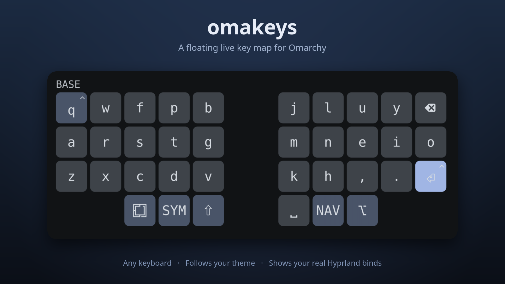

# omakeys

**A floating live key map for Omarchy: see what every key does on the layer you are on.**



- Works with any keyboard. Laptop, USB and Bluetooth boards get an ANSI layout that lights up as you type.
- QMK boards get the full layer map. The board is described by one small TOML file.
- Follows your Omarchy theme. Switch themes and the overlay recolors, no restart.
- Hold Super, Ctrl or Alt and it shows your real Hyprland binds on the keys.
- Uninstalls clean with one command.

## Install

You need Omarchy (Hyprland on Wayland). Then:

```bash
git clone https://github.com/FarzadHayat/omakeys
cd omakeys
./overlay/dist/install-desktop.sh
```

It builds the app, adds an **Omakeys** menu entry and bar icon, and starts it at login. It asks for `sudo` once to let your user read keyboards (udev rule and `input` group). Log out and in after the first install, then run:

```bash
omakeys doctor
```

`doctor` checks everything and tells you what to fix.

## Use it

- **Toggle:** `Super + Alt + O` after you add the bind below, or run `omakeys toggle`.
- **Settings:** left-click the bar icon, or run `omakeys settings`.
- **Pick a board:** Auto follows whichever keyboard you type on. Pin one in settings to lock it.

### Add the toggle key

Nothing is bound for you, so your Hyprland config is never touched. `Super + Alt + O` is unused by Omarchy defaults. The installer prints the exact line for your machine. Add it to `~/.config/hypr/bindings.lua`:

```lua
o.bind("SUPER + ALT + O", "Omakeys overlay", "/home/you/.cargo/bin/omakeys toggle")
```

Older `.conf` setups:

```
bind = SUPER ALT, O, exec, /home/you/.cargo/bin/omakeys toggle
```

Use the full path: Hyprland often does not have `~/.cargo/bin` on its PATH.

## Use it with your own keyboard

Pick the case that fits.

1. **Any normal keyboard.** Nothing to do. Auto (or `generic`) already lights up keys on a standard ANSI layout. Non-US layouts light the right keys but show US legends.
2. **A QMK board with layers.** Two steps:
   1. Your firmware must report layers over Raw HID. Add the `omakeys_notify` QMK module (`modules/omakeys/omakeys_notify`). KeyPeek or LayerLens modules also work.
   2. Copy [`examples/boards/example.toml`](examples/boards/example.toml) to `~/.config/omakeys/boards/<name>.toml` and fill in your USB ids, layer names and key positions. Run `omakeys doctor` to see your board's ids.

   The app picks the new file up within a couple of seconds. Re-run the install script once so the udev rule covers your board.
3. **An odd laptop layout.** Run `omakeys keys` and press keys to see their Linux codes. Custom evdev layouts are not TOML yet: use Generic, or send a pull request with a Rust layout (see the Samsung Trio 500 profile).

## Settings

Everything lives in `~/.config/omakeys/config.toml`. The settings panel edits it for you. The most useful keys:

| Key | What it does |
| --- | --- |
| `board` | `auto`, `generic`, or a board name |
| `anchor`, `scale`, `opacity` | where it sits and how big |
| `[hover] mode` | what the pointer does: `type` (default), `dodge`, `tooltip`, `off` |
| `[binds] enabled` | show your Hyprland binds while a modifier is held |

All options, hover modes, the on-screen keyboard mode and per-key overrides: [docs/reference.md](docs/reference.md).

## Uninstall

```bash
./overlay/dist/install-desktop.sh --uninstall
```

Removes the service, menu entry, icons, bar icon and udev rule, and uninstalls the binary. Your config is kept unless you add `--purge`. Two things the script cannot safely undo for you: the bind line in `bindings.lua`, and your `input` group membership (`sudo gpasswd -d $USER input`).

## Good to know

- Run one overlay at a time. Overlays and VIA share Raw HID.
- The `input` group can read every keyboard on the machine. Only install on a machine you trust.
- Hover "type" mode needs write access to `/dev/uinput`.
- Check or stop the daemon: `systemctl --user status omakeys.service`.

## Develop

```bash
cargo test --manifest-path overlay/Cargo.toml
cargo run --manifest-path overlay/Cargo.toml -- run
```

Commands: `omakeys run | toggle | settings | boards | keys | doctor | udev-rules`.

## License

MIT, see [LICENSE](LICENSE). Made for the Omakeys LoremIpsum36 keyboard. The keyboard firmware in this repo is GPL-3.0.
